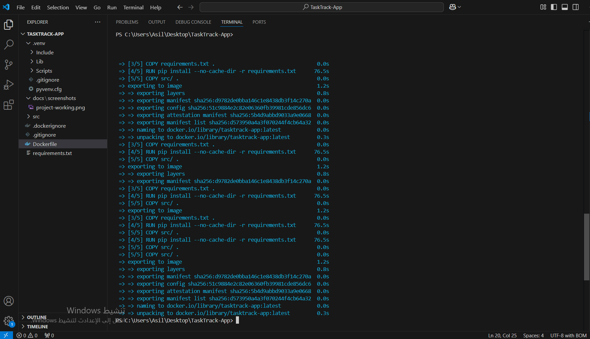
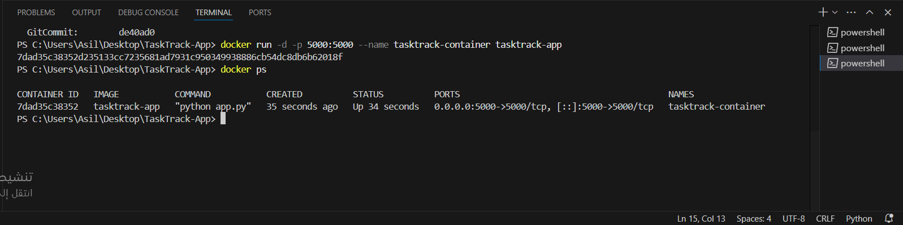
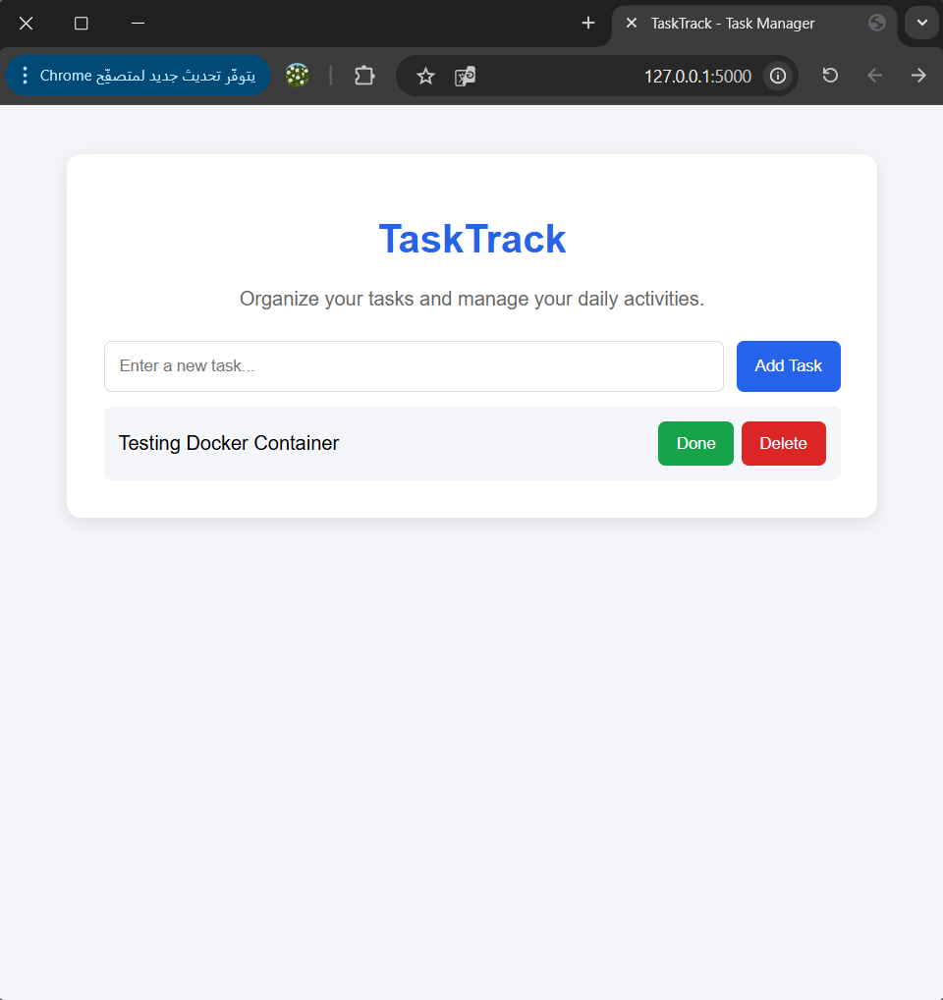
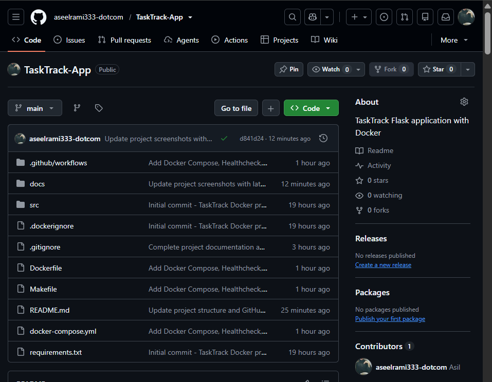
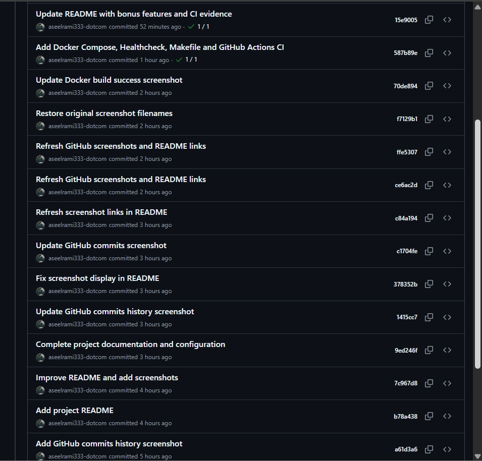
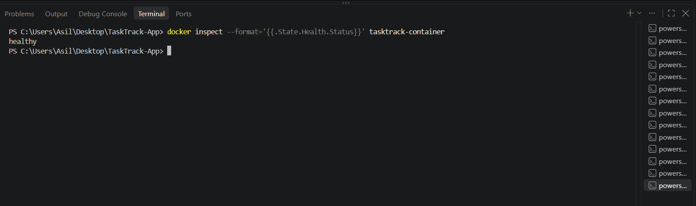
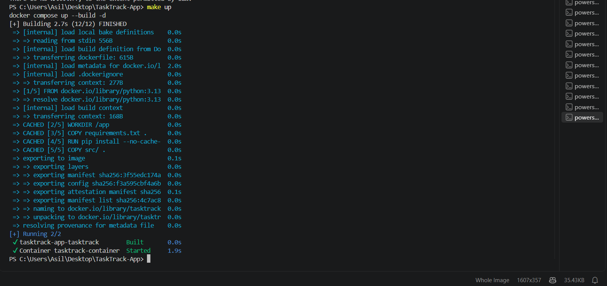
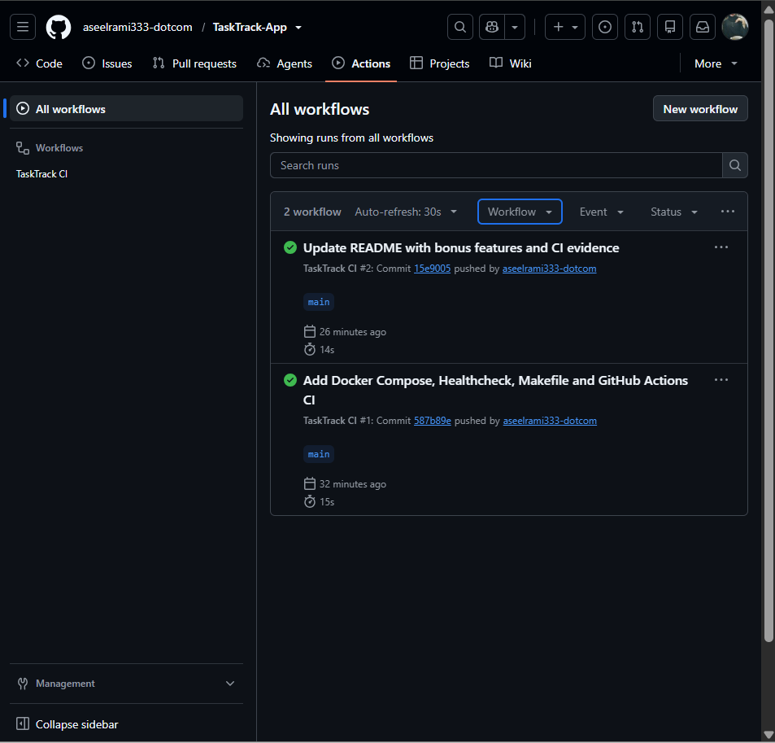

# TaskTrack App

## About the Project

TaskTrack is a simple web application that helps users manage their daily tasks. Users can add tasks, mark them as completed, and delete tasks.

I built this project using Python and Flask, and used Docker to run the application inside a container.

## Technologies Used

- Python
- Flask
- HTML and CSS
- Docker
- Git and GitHub

## Project Structure

```text
TaskTrack-App/
├── .github/
│   └── workflows/
│       └── ci.yml
├── docs/
│   ├── screenshots/
│   └── notes.md
├── src/
│   ├── app.py
│   └── templates/
│       └── index.html
├── .dockerignore
├── .gitignore
├── Dockerfile
├── docker-compose.yml
├── Makefile
├── README.md
└── requirements.txt
```

## How to Run the Project

Make sure Docker Desktop is running before starting the application.

Build the Docker image:

```bash
docker build -t tasktrack-app .
```

Run the container:

```powershell
docker run -d -p 5000:5000 `
  --name tasktrack-container `
  tasktrack-app
```

Open the application in your browser:

http://localhost:5000

## Screenshots

The following screenshots show the application and Docker setup.

### 1. Project Working


### 2. Docker Build



### 3. Docker Container Running



### 4. Docker Project



### 5. GitHub Commits


### 6. GitHub Commits History


## How to Stop the Container

To stop the running container, use:

```bash
docker stop tasktrack-container
```

## How to Clean Up

To remove the stopped container, use:

```bash
docker rm tasktrack-container
```

To remove the Docker image, use:

```bash
docker rmi tasktrack-app
```

## Application Testing

After starting the container, open the following URL in your browser:

http://localhost:5000

The application can be tested by performing the following actions:

- Add a new task.
- Mark a task as completed.
- Delete a task.

These tests help verify that the main application features are working correctly.

## Configuration

- Application port: 5000
- Docker port mapping: 5000:5000
- Container name: tasktrack-container
- Docker image name: tasktrack-app

## Docker Compose

Docker Compose makes it easier to build and run the application using a single command.

Build and start the application:

```bash
docker compose up --build -d
```

Check the running container:

```bash
docker compose ps
```

View application logs:

```bash
docker compose logs
```

Stop the application:

```bash
docker compose down
```

## Healthcheck

The Dockerfile includes a HEALTHCHECK instruction to automatically monitor the application.

Docker checks the application every 30 seconds to make sure it is responding.

To check the container health status, use:

```bash
docker ps
```

A healthy application displays the status:

```text
Up (healthy)
```

## Makefile

The project includes a Makefile to simplify common Docker commands.

The following commands are available:

| Command | Description |
|---|---|
| `make up` | Build and start the application |
| `make down` | Stop and remove containers |
| `make build` | Build the Docker image |
| `make logs` | Display application logs |
| `make ps` | Display container status |
| `make clean` | Stop containers and remove the local image |

GNU Make must be installed to use these commands.

## GitHub Actions CI

The project uses GitHub Actions for Continuous Integration (CI).

The workflow is triggered automatically when changes are pushed to the main branch or when a pull request targets main.

The workflow performs the following steps:

1. Checks out the repository.
2. Validates the Docker Compose configuration.
3. Builds the Docker image.

A successful workflow run confirms that the Docker configuration is valid and the image can be built.

## Additional Screenshots

### 7. Healthcheck Status



### 8. Makefile Execution



### 9. GitHub Actions CI




